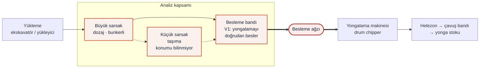

## 1. Kapsam ve yöntem

İncelenen ünite, Efo Makina'nın yonga üretim hattındaki **besleme bandı** ve **sarsak** (titreşimli konveyör) bölümüdür. Firmayla iletişim kurulmadı; bütün bilgiler kamuya açık kaynaklardan geldi. Ana girdi, daha önce hazırlanmış bağımsız bir derin araştırma raporudur (R kaynakları). Raporun kritik iddiaları linklerinden kontrol edildi ve gerekli yerlerde yeni kaynaklar eklendi (Y kaynakları). Efo'nun sitesindeki fotoğraflar, renderlar ve broşür görselleri tarayıcıyla tek tek incelendi.

| Etiket | Anlamı |
|---|---|
| [EFO-DOĞRULANMIŞ] | Efo'nun kendi kaynağından ya da AİMSAD/TWM'den gelen bilgi |
| [SEKTÖR-TİPİK] | Benzer makineler, standartlar, rehberler |
| [ÇIKARIM] | Kaynağa dayalı yorum |
| [VARSAYIM] | Kaynak yok; tipik kurulum üzerinden kabul |

## 2. Rapor doğrulama notları

### 2.1 Analizi etkileyen düzeltmeler

| # | Rapordaki iddia | Kontrol sonucu | Analize etkisi |
|---|---|---|---|
| D1 | Hat sırası "bant → sarsak → yongalama" [EFO-DOĞRULANMIŞ] | Efo yalnızca beslemenin "sarsak ve bantlar" üzerinden yapıldığını yazıyor; sıra vermiyor [R29]. Havadan çekilmiş hat fotoğrafında yongalama makinesine giren son ünite uzun bir konveyör [Y3]. | Etiket [ÇIKARIM] olmalı. Besleme ağzına komşu ünite **besleme bandı** kabul edildi (V1). |
| D2 | Panolarda Siemens, Lenze, SEW logoları | Dokuz logo (SKF, SNR, Siemens, SEW, Lenze, Hardow, ESTA, CTL, Camak) her sayfada ortak şeritte duruyor ve hiçbir parçayla ilişkilendirilmemiş [R4, R22]. SKF ve SNR rulman, SEW ve Lenze motor-redüktör üreticisi. Raporun kendi A.6 bölümü de logoların yalnızca sitede olduğunu söylüyor. | PLC ve invertör **bilinmiyor**. Benchmark tablosundaki "S7-1200 + Lenze/SEW VFD" Efo satırı tahmin; V2–V3 olarak işaretlendi. |
| D3 | PLr: özette "c veya d", Bölüm D'de "S2+F2+P2 → d veya e" | ISO 13849-1 risk grafiğinde S2+F2+P2 kesin olarak **PL e**; PL d için S2+F2+P1 ya da S2+F1+P2 gerekir [Y21]. | İç tutarsızlık. LAB 1'de 8 kombinasyonun standart tablosu koddan üretilecek. |
| D4 | CVE-2020-28400 "bozuk HTTP paketi" | Tetikleyici çok sayıda PROFINET DCP reset paketi; CVSS 3.1 = 7.5 doğru (SSA-599968) [Y13]. | DCP katman-2 bir protokol; saldırganın aynı ağ segmentinde olması gerekir [ÇIKARIM]. |
| D5 | SSA-688146, S7-1200 bağlamında | Bildirim S7-1500, ET 200SP ve Drive Controller için; S7-1200 etkilenenler listesinde yok (12.05.2026, CVSS 3.1 = 9.1) [Y14]. | S7-1200 senaryosundan çıkarıldı. |
| D6 | CVE-2024-47100 | Doğru: S7-1200 < V4.7, web arayüzünde CSRF, saldırgan oturum açmış bir kullanıcıyı bir linke tıklatarak CPU çalışma modunu değiştirebilir; CVSS 3.1 = 7.1, 4.0 = 7.2 (SSA-717113) [Y12]. | LAB 3'te kapı adayı. |
| D7 | DoS → "interlock çalışmaz, mekanik patlama" | PLC STOP'a düştüğünde çıkışlar genelde sıfıra gider ve bant durur. | Abartılı [ÇIKARIM]. Asıl fiziksel risk: parametre değişikliği ve beklenmedik yeniden başlama. |
| D8 | Kıstırma noktası için S=3 dayanağı (HSE yumurta çiftliği) | Mekanizma doğru; sonuç iki kolda sinir hasarı ve üç ayda iyileşme. Tahrik ucunda sabit ya da kilitli koruyucu yoktu; 53.000 £ ceza [R39]. | Bu bir **S=2** kanıtı. |
| D9 | Besleme ağzına çekilme için S=3 dayanağı (blog yazısı, linksiz "OSHA verisi") | OSHA SHIB 04-16-2008: 1996–2005 arasında yongalama makinelerinde 39 ölüm; bunların %78'i makineye çekilme [Y9]. OSHA kaza kaydı 688978: elle besleme sırasında çekilerek ölüm [Y10]. | S=3 dayanağı bu kaynaklar. Kayıtlar mobil yongalama makinelerine ait; konveyörle beslenen sabit hatta analoji olarak kullanılır [SEKTÖR-TİPİK]. |
| D10 | STO "kontaktör yapışması ve yazılım riskini ortadan kaldırır" | STO motoru elektriksel olarak ayırmaz; bakım için enerji ayırma ve kilitleme (LOTO) hâlâ gerekir [R49]. | İfade yumuşatıldı. |
| D11 | NIST SP 800-82 ve IEC 62443 "şart koşar / zorunlu kılar" | Rehber ve standarttır, yasal zorunluluk değildir. NIST'e ikincil bloglar üzerinden atıf yapılmış [R13, R14]. | Birincil kaynak olarak ACSC rehberi eklendi [Y15]. |
| D12 | Lenze satırının kaynağı (R52) | Alakasız bir sunum. Lenze i500 WLAN modülü çalışma sırasında telefondan parametre değiştirmeye izin veriyor [Y17]. | PaketPro'daki Wi-Fi zayıflığının olası karşılığı; Efo'nun bu ürünü kullandığı bilinmiyor. |
| D13 | Bölüm H: "VVR sarsak" | VVR, Vecoplan'ın ürün adıdır [R30]. | Düzeltildi. |
| D14 | "6 milyon m³ MDF, dünya 2." | Kaynak 2016 tarihli ve kaynaksız [R17]. | SWOT'ta tarih notuyla kullanılacak. |
| D15 | WoodTech katılımı "tespit edilemedi" | Efo'nun Instagram hesabında "Woodtech 2024" başlıklı öne çıkan hikâye var [Y8]. Ziyaretçi mi katılımcı mı olduğu belli değil. | Fuar görünürlüğü iddiası zayıfladı. |
| D16 | Mevzuat tarihleri | 2023/1230 AB'de 20.01.2027'den itibaren uygulanır [Y18]. TR Makine Emniyeti Yönetmeliği (2023/1230/AB) 16.10.2026'da yayımlandı (RG 33402) [Y19]; yürürlük maddesi birincil kaynaktan okunamadı. CRA: 10.12.2024 yürürlük, 11.06.2026 onaylanmış kuruluşlar, 11.09.2026 bildirim yükümlülüğü (24 sa / 72 sa / 14 gün), 11.12.2027 tam uygulama; ceza üst sınırı 15 M€ ya da cironun %2,5'i [Y20]. | Tarihler doğru. Rapordaki tabloda 16 Ekim satırı 11 Eylül'ün önünde; sıra hatası. |

### 2.2 Efo kaynaklarından doğrulananlar

| Bilgi | Durum | Kaynak |
|---|---|---|
| Unvan: Efo Makina İnşaat Gıda San. ve Tic. Ltd. Şti.; adres: İnönü Mah. 145. Sk. No:101, 35885 Torbalı, İzmir | Doğrulandı | [Y7] |
| AİMSAD bağlantısı | Dolaylı: firma TWM'de "Üyelerimiz > Mağazalar" altında listeleniyor | [Y7] |
| Besleme bandı ihtiyaca göre üretiliyor; "ekstra dayanıklı" malzeme; bantla besleme kapasiteyi artırıyor | Doğrulandı (Efo broşür görseli ve TWM ilanı) | [Y2, Y6] |
| Hatta iki sarsak var; büyük olan dozajlıyor, diğeri taşıyor | Doğrulandı (Efo sarsak broşürü ve TWM ilanı) | [Y1, Y5] |
| Helezon, yongalama makinesinden çıkan yongayı çavuş bandına aktarıyor | Doğrulandı | [R3] |
| Teknik veri (güç, kapasite, hız, PLC, sensör, emniyet donanımı) | Hiçbir sayfada yok | [R3, R4, R28] |
| "Belgelerimiz" sayfası | Sertifika yok; yalnızca aynı dokuz logo | [R22] |
| Yongalama makinesinin "Avrupa normlarına uygun" üretildiği ifadesi | Ürün sayfasında var (raporda yok) | [Y4] |
| "Yedek Parça" ve "Teknik Destek" hizmetleri | Sitede kategori olarak var (raporda yok) | [Y3] |
| Instagram: "Cips Makinaları İmalatı", "Woodtech 2024" hikâyesi | Görüldü; gönderilerin çoğu giriş duvarının arkasında | [Y8] |

### 2.3 Görsel inceleme

Medya merkezinde 8 fotoğraf var, video yok. Ürün sayfalarındaki render ve broşür görselleri de incelendi. Fotoğrafların Efo'nun tesisinde mi yoksa bir müşteri sahasında mı çekildiği belli değil. Görseller repoya konmadı; yalnızca linkleri kaynak listesinde.

| Görsel | Ne görünüyor | Analize etkisi |
|---|---|---|
| Havadan hat fotoğrafı | Odun yığınından sundurma altındaki yongalama makinesine uzanan uzun bir konveyör; çıkışta eğimli bir bant yongayı yığına atıyor; konveyörün yanında bir kişi [Y3] | Yongalama makinesine giren son ünite bir konveyör → V1'i destekler [ÇIKARIM] |
| Saha fotoğrafı | Ekskavatör odunları bunkerli bir üniteye yüklüyor; eğimli konveyör sundurmaya çıkıyor; sundurmada camlı bir operatör kabini; hat yanında iki kişi [Y3] | Yükleme mekanik; HMI/pano büyük ihtimalle kabinde (V3) [ÇIKARIM] |
| Yukarıdan yakın çekim | Yan duvarlı bant üzerinde tomruk; bir çalışan bandın hemen yanındaki ızgara platformda, bir diğeri bandın yanında; yanlarında 2–3 butonlu beyaz bir kumanda kutusu. Bu açıdan bant boyunca çekme ipi ve sarı zeminli kırmızı mantar buton seçilemiyor [Y3] | F2 (sık ve yakın maruziyet) için görsel kanıt; yerel kumanda istasyonu var. Çekme ipinin olmadığı **kesin değil** [ÇIKARIM] |
| Çalışan fotoğrafı | Efo montlu çalışan baret ve kulaklık takıyor [Y3] | Gürültü tehlikesi KKD ile yönetiliyor [ÇIKARIM] |
| Atölye fotoğrafları | CNC işleme ve taşlama [Y3] | Atölyede talaşlı imalat kabiliyeti (SWOT) [EFO-DOĞRULANMIŞ] |
| Besleme bandı renderları ve broşürü | Yüksek yan duvarlı bant; rulman yataklı taşıyıcı makaralar; kauçuk kaplı (elmas desenli) tahrik tamburu; tambura bağlı motor-redüktör; kuyrukta vidalı gergi; bandın üstünde sarı bir portal ve içinde sarkan plakalar. Tambur koruyucusu, acil stop, çekme ipi ve sensör çizilmemiş [Y2] | Bileşen listesi netleşti. Baş ve kuyruk tamburundaki kıstırma noktaları renderda açık. Renderlar genelde koruyucusuz çizildiği için ürün hakkında bir hüküm **değildir** [ÇIKARIM] |
| Sarsak broşürü | İki tip: büyük olanın üstünde geniş bir dozaj bunkeri; küçük olanda delikli bir plaka bölümü. Bir uçta kasnak, teknenin altında eğik kollar ve bir bağlantı kolu [Y1] | Tahrik büyük ihtimalle kasnaklı eksantrik ve kollu; raporun "titreşim motoru" tahmini zayıfladı. Açık kollar ve kasnak sıkışma noktası (EN 618) [ÇIKARIM] |

## 3. Makine profili

### 3.1 Ne yapar?

- **Besleme bandı:** Odun, tomruk ve ahşap atığını yongalama makinesine taşıyan bantlı konveyör. Uzunluk ve genişlik müşteriye göre belirleniyor. Firmaya göre bantla beslemek makine kapasitesini artırıyor [EFO-DOĞRULANMIŞ] [Y2, Y6].
- **Sarsak:** Titreşimli konveyör. Hatta iki tip var: büyük olan malzemeyi dozajlıyor, diğeri taşıyor [EFO-DOĞRULANMIŞ] [Y1, Y5].
- **Ortak amaç:** Yongalama makinesine düzenli ve sürekli malzeme vermek. Titreşim, parçaların birbirine takılıp köprü kurmasını önler [ÇIKARIM] [R30, R31].
- **Taşınan malzeme:** Tomruk, orman atığı, kısa bloklar, kaplama artıkları, palet hurdası, ağaç kabuğu [SEKTÖR-TİPİK] [R2].
- **Ürünün kullanıldığı yer:** Yonga levha ve MDF fabrikaları, biyokütle santralleri, pelet üreticileri, palet ve kereste sektörü [EFO-DOĞRULANMIŞ] [R2].

### 3.2 Hattaki yeri

- Helezon → çavuş bandı sırası Efo kaynaklarında yazıyor [EFO-DOĞRULANMIŞ] [R3, R29].
- Besleme bandı ile sarsakların sırası Efo kaynaklarında yok. Yukarıdaki sıra bir kabuldür [VARSAYIM] (V1).
- Besleme ağzı ayrı işaretlendi, çünkü en ağır tehlike oradadır: malzemeyle birlikte el ya da kol yongalama makinesine çekilebilir (LAB 1).

### 3.3 Bileşenler

| Ünite | Bileşen | Bilgi | Etiket | Kaynak |
|---|---|---|---|---|
| Besleme bandı | Gövde | Yüksek yan duvarlı (etekli) çelik konstrüksiyon | [EFO-DOĞRULANMIŞ] (render) | [Y2] |
| Besleme bandı | Taşıyıcı makaralar | Rulman yataklı makara dizisi | [EFO-DOĞRULANMIŞ] (render) | [Y2] |
| Besleme bandı | Tahrik | Kauçuk kaplı tahrik tamburu + tambura bağlı motor-redüktör | [EFO-DOĞRULANMIŞ] (render) | [Y2] |
| Besleme bandı | Gergi | Kuyruk tamburu, vidalı gergi | [EFO-DOĞRULANMIŞ] (render) | [Y2] |
| Besleme bandı | Bant üstü portal | Sarı portal ve sarkan plakalar; perde, seviye kapağı ya da metal dedektörü olabilir | [ÇIKARIM] | [Y2] |
| Besleme bandı | Hız kontrolü | Frekans invertörü (VFD), STO girişli | [VARSAYIM] (V2) | [R6, R30] |
| Sarsak (büyük) | Tekne + bunker | Geniş bunker, dozaj işlevi | [EFO-DOĞRULANMIŞ] | [Y1, Y5] |
| Sarsak (küçük) | Tekne | Uzun tekne, delikli plaka bölümü (işlevi belirlenemedi) | [ÇIKARIM] | [Y1] |
| Sarsak | Tahrik | Kasnak + eğik kollar + bağlantı kolu → eksantrik ve kollu tahrik | [ÇIKARIM] | [Y1] |
| Hat | Yerel kumanda | Bant yanında 2–3 butonlu kumanda kutusu | [ÇIKARIM] (fotoğraf) | [Y3] |
| Hat | Operatör kabini | Sundurmada camlı kabin | [ÇIKARIM] (fotoğraf) | [Y3] |
| Hat | PLC ve HMI | Marka/model bilinmiyor; S7-1200 sınıfı bir PLC ve kabinde bir panel kabul edildi | [VARSAYIM] (V3) | [R6] |
| Hat | Emniyet donanımı | Kamuya açık kaynakta görülmedi. Tipik yapı: acil stop butonları, bant boyunca çekme ipi, kilitli kapaklar, emniyet rölesi, STO | [SEKTÖR-TİPİK] / [VARSAYIM] (V4) | [R33, R34, R45] |
| Hat | Yongalama makinesiyle bağlantı | Yongalama durursa besleme durur; aşırı akımda besleme yavaşlar | [SEKTÖR-TİPİK] / [VARSAYIM] (V7) | [R6, R30] |
| Hat | Uzaktan erişim | Bilinmiyor. Tipik KOBİ pratiği: panoda 4G/VPN router ya da TeamViewer/AnyDesk | [VARSAYIM] (V5) | [R13] |
| Tedarik | Logolar | SKF, SNR (rulman); Siemens; SEW, Lenze (motor-redüktör, sürücü); Hardow, ESTA, CTL, Camak (tanımlanamadı). Hiçbiri belirli bir parçaya bağlanmamış | [EFO-DOĞRULANMIŞ] (logolar) / [ÇIKARIM] (anlamı) | [R4] |

### 3.4 Çalışma ortamı ve insanla etkileşim

- **Yükleme** ekskavatörle yapılıyor; operatör yükleme sırasında makineden uzakta [ÇIKARIM] [Y3].
- **Bandın yanında insan var:** Fotoğraflarda çalışanlar bant kenarında ve hemen yanındaki platformda. Sıkışan tomruğu düzeltmek, temizlik ve gözetim bu yakınlığı gerektiriyor [ÇIKARIM] [Y3]. LAB 1'de maruziyet F2 seçilirken bu kullanılacak.
- **Gürültü ve toz:** Çalışan baret ve kulaklık takıyor; ortam açık sundurma [ÇIKARIM] [Y3].
- **Bakım:** Bant gerginliği, makara ve tambur bakımı, sarsakta kol ve yatak bakımı periyodik olarak insan müdahalesi gerektirir [SEKTÖR-TİPİK] [R42].

### 3.5 Bilinenler ve bilinmeyenler

| Konu | Bilinen | Bilinmeyen | Analizde nasıl dolduruluyor |
|---|---|---|---|
| İşlev | Besleme, dozaj, taşıma | Kapasite (t/sa, m³/sa) | Kapasite kullanılmıyor |
| Hat düzeni | Helezon → çavuş bandı; iki sarsak | Bant ile sarsakların sırası | V1 |
| Mekanik | Bileşen tipleri (render) | Ölçü, bant hızı, motor gücü | V6: sektör-tipik değerler (LAB 1, `params.yaml`) |
| Tahrik ve kumanda | Motor-redüktör; yerel buton kutusu; kabin | PLC, HMI, invertör marka/modeli | V2, V3 |
| Emniyet | — | Acil stop, çekme ipi, kilitli kapak, sensör, PLr, risk değerlendirmesi | V4 (tipik yapı, Efo'ya ait değil) |
| Yongalama ile bağlantı | Aynı hattın parçası | Sinyal tipi ve mantık | V7 |
| Ağ ve uzaktan erişim | — | Router, VPN, bulut, parola prosedürü | V5 |
| Belgeler | "Avrupa normlarına uygun" ifadesi | CE beyanı, ISO belgeleri, teknik dosya | Analiz CE uygunluğu iddiası taşımaz |

**Varsayım kimlikleri** (Bölüm 05'teki varsayımlar tablosunda toplanacak):

| Kimlik | Varsayım | Kullanıldığı yer |
|---|---|---|
| V1 | Yongalama makinesini doğrudan besleyen ünite besleme bandıdır. | LAB 1, LAB 3 |
| V2 | Bant ve sarsak motorları frekans invertörüyle sürülür; invertörlerde STO girişi vardır. | LAB 1–4 |
| V3 | Hat standart bir PLC ile kumanda edilir (S7-1200 sınıfı); operatör kabininde bir HMI ya da panel vardır. | LAB 1–4 |
| V4 | Emniyet zinciri tipik yapıdadır: acil stop + çekme ipi + kilitli kapaklar → emniyet rölesi → STO / kontaktör. | LAB 1, LAB 4 |
| V5 | Uzak destek tipik KOBİ pratiğiyle yapılır: panoda sürekli açık bir 4G/VPN router ya da ticari bir uzak masaüstü aracı. | LAB 2–4 |
| V6 | Sayısal değerler (bant hızı, mesafeler, durma süreleri) sektör-tipik değerlerdir. | LAB 1, LAB 3 |
| V7 | Yongalama makinesi ile besleme arasında bir interlock vardır: yongalama durursa besleme durur. | LAB 1, LAB 3 |

## 4. Ek sorular: zafiyet adayları ve nasıl kapatılır

Bu bölüm föy dışıdır ve kullanıcı isteğiyle eklendi. Bulgular kamuya açık görsel ve belgelere dayanır. Öneriler genel sektör pratiğidir. Efo'nun bunları zaten uyguluyor olup olmadığı bilinmiyor; tasarım kararı firmaya aittir.

QE1 | Kamuya açık görsellerde hangi mekanik zafiyet adayları görünüyor ve nasıl kapatılır?

- **Bulgu:** Renderlarda besleme bandının baş ve kuyruk tamburu, sarsağın kasnağı ve kolları açık çizilmiş [ÇIKARIM] [Y1, Y2].
- **Neden önemli:** Dönen tambur ile bant arasındaki kıstırma noktası kolu içeri çeker. HSE vakasında tahrik ucunda sabit koruyucu yoktu [R39].
- **Kapatma:** Tahrik ve kuyruk uçlarını, alet olmadan sökülemeyen sabit koruyucularla kapatmak. Sık açılması gereken kapakları kilitli yapmak (ISO 14119). Koruyucu açıklıklarını güvenlik mesafelerine göre seçmek (ISO 13857). Sarsakta kollar ve kasnak için muhafaza (EN 618) [SEKTÖR-TİPİK] [R38, R46].

QE2 | Bandın yanında çalışan bir kişi makineyi her noktadan durdurabilir mi?

- **Bulgu:** Fotoğrafta çalışanlar bant kenarında. Bu açıdan bant boyunca çekme ipi ve sarı zeminli kırmızı mantar buton seçilemiyor [ÇIKARIM] [Y3].
- **Neden önemli:** Kapılan kişi uzaktaki bir butona uzanamaz; durdurma, bandın her noktasından mümkün olmalı.
- **Kapatma:** Bant boyunca iki taraftan erişilebilen çekme ipli acil stop (ISO 13850). Kumanda kutusunda da bir acil stop. Reset ayrı ve bilinçli bir eylem olmalı; reset makineyi kendiliğinden çalıştırmamalı [SEKTÖR-TİPİK] [R33, R42].

QE3 | Besleme ağzına elle müdahale nasıl önlenir?

- **Bulgu:** Yongalama makinesi ölümlerinin büyük kısmı makineye çekilmeyle oluyor [Y9]. Elle besleme sırasında çekilerek ölüm kaydı var [Y10].
- **Kapatma:** Besleme ağzına erişimi mesafeyle sınırlamak (WorkSafe Victoria, besleme ağzının ön kenarından merdanelere en az 1500 mm öneriyor) [Y11]. Sıkışmayı elle değil, ters yön kumandası ya da itme aletiyle açmak. Besleme ağzı çevresinde bir acil durdurma tertibatı [Y9]. Müdahaleden önce enerjiyi kesip kilitlemek (LOTO).

QE4 | Bakım sırasında makinenin kendiliğinden çalışması nasıl önlenir?

- **Neden önemli:** Raporun kaza verisinde bakım sırasında beklenmedik çalışma ayrı bir kaza türü olarak geçiyor [R33].
- **Kapatma:** Kilitlenebilir ana şalter ve LOTO prosedürü. STO tek başına bakım için yeterli değildir, çünkü motoru elektriksel olarak ayırmaz [R49]. Acil stop ya da kapak resetinden sonra otomatik yeniden başlama olmamalı (ISO 14118) [SEKTÖR-TİPİK].

QE5 | Dijital tarafta hangi zafiyetler beklenir ve nasıl kapatılır?

- **Bulgu:** PLC, invertör ve uzaktan erişim kamuya açık kaynaklarda yok (V2, V3, V5). Tipik bileşenlerde bilinen örnekler şunlar:
    - S7-1200'de V4.7 öncesi sürümlerde CSRF açığı: saldırgan, oturum açmış bir kullanıcıyı bir linke tıklatarak CPU çalışma modunu değiştirebilir [Y12].
    - PROFINET DCP reset paketleriyle hizmet dışı bırakma [Y13].
    - Çalışma sırasında telefondan parametre değiştirmeye izin veren invertör WLAN modülü [Y17].
    - Sürekli açık bırakılan VPN router'lar [R13].
- **Kapatma:**
    - Firmware'i güncel tutmak; S7-1200 için en az V4.7.
    - Kullanılmıyorsa PLC web sunucusunu kapatmak.
    - Makine ağını fabrika ağından ayırmak (zone/conduit).
    - WLAN modülünü devreye almadan sonra sökmek ya da kapatmak.
    - Uzaktan erişimi varsayılan olarak kapalı, MFA'lı ve kişisel hesaplı yapmak [Y15].

  Ayrıntılar LAB 2–4'te [SEKTÖR-TİPİK].

QE6 | Kamuya açık belge eksikliği bir zafiyet midir?

- **Bulgu:** "Belgelerimiz" sayfasında sertifika yok; teknik veri ve emniyet bilgisi yayınlanmamış [R22].
- **Neden önemli:** Müşteri ve denetçi emniyet seviyesini dışarıdan doğrulayamaz. 20.01.2027'den sonra piyasaya arz edilen makinelerde Ek III'ün kontrol sistemi bozulmasına karşı koruma gerekleri de gösterilmek zorunda [Y18, Y19].
- **Kapatma:** 2023/1230, kullanım kılavuzu ve uygunluk beyanının dijital olarak (link ya da QR kod) sunulmasına izin veriyor [R15]. Emniyet fonksiyonları ve hedef PL seviyeleri kılavuzda özetlenebilir [ÇIKARIM].
