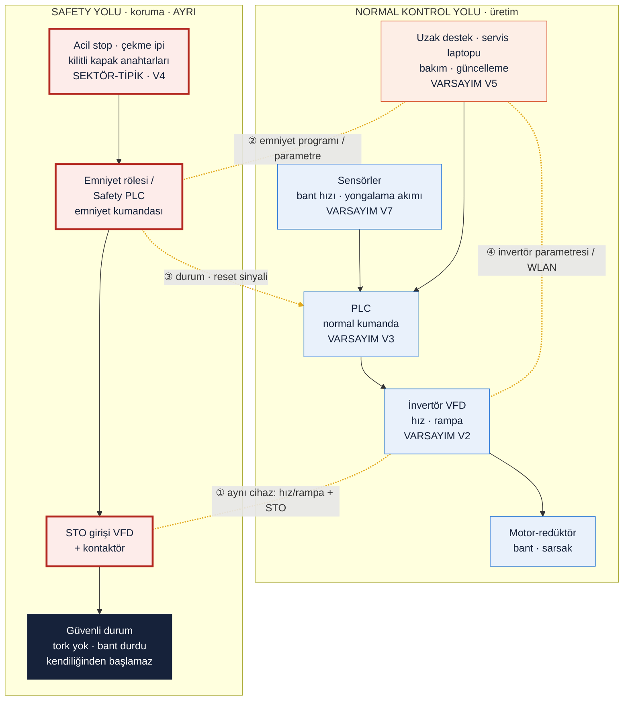

## Safety Function Map

## Görev — sırayla cevaplar

Q1 | Bu makinede tehlike nedir? İnsan neyden zarar görür?

İnsan en çok **besleme ağzında** zarar görür. Bant malzemeyi yongalama makinesine iterken bandın üstündeki ya da sıkışmayı açmaya çalışan elin, eldivenin veya kıyafetin malzemeyle birlikte rotora çekilmesi ölümcüldür. Yongalama makinesi ölümlerinin büyük bölümü bu mekanizmayla oluyor [Y9, Y10]. İkinci büyük tehlike, dönen tamburlarla bant arasındaki **kıstırma noktalarıdır**. Efo renderlarında bu noktalar açık çizilmiş, ancak bu ürünün koruyucusuz satıldığını göstermez [Y2].

| Tehlike | Nerede | Mekanizma | Olası zarar | Ön S | Dayanak |
|---|---|---|---|---|---|
| Besleme ağzına çekilme | Bandın yongalama makinesine girdiği uç (V1) | El, eldiven, kıyafet ya da levye malzemeyle birlikte rotora kapılır | Ölüm, uzuv kaybı | 3 | [Y9, Y10] [SEKTÖR-TİPİK] |
| Kıstırma (nip point) | Baş ve kuyruk tamburu, makaralar | Dönen tambur ile bant arasına çekilme | Kol ezilmesi, sinir hasarı, uzuv kaybı | 2–3 | [R38, R39] [SEKTÖR-TİPİK]; renderda açık [Y2] [ÇIKARIM] |
| Sarsakta sıkışma ve ezilme | Eksantrik kollar, kasnak, tekne ile şasi arası | Salınan tekne ile sabit şasi arasında makaslama | Parmak ve el ezilmesi | 2 | [R46] [SEKTÖR-TİPİK]; kollar renderda açık [Y1] [ÇIKARIM] |
| Beklenmedik çalışma | Bakım ve temizlik sırasında tambur ve sarsak yanı | Enerji ayrılmadan ya da reset sonrası kendiliğinden çalışma | Ezilme, çekilme | 3 | [R33] [SEKTÖR-TİPİK] |
| Parça fırlaması | Besleme ağzı | Yonga ve parça fırlaması, geri tepme | Göz ve yüz yaralanması | 2 | [Y9, Y11] [SEKTÖR-TİPİK] |
| Gürültü, titreşim, ahşap tozu | Hat geneli | Sürekli maruziyet | İşitme kaybı, solunum hastalığı | 1–2 | Çalışanlar kulaklık takıyor [Y3] [ÇIKARIM] |

Q2 | Emniyet fonksiyonu (safety function) hangisidir?

Bu ünite için dört emniyet fonksiyonu tanımlandı. Efo'da var olup olmadıkları bilinmiyor; aşağıdaki liste benzer makinelerin tipik yapısına göre **olması gereken** settir [SEKTÖR-TİPİK] [R30, R31, R33] (V4).

| Kimlik | Emniyet fonksiyonu | Tetikleyici | Tepki | Güvenli durum |
|---|---|---|---|---|
| SF1 | Acil durdurma | Acil stop butonu ya da bant boyunca çekme ipi | Bant ve sarsak torku kesilir (STO) | Tork yok, bant durdu, kilitli |
| SF2 | Koruyucu kilitleme | Tambur ya da sarsak muhafazasının açılması (ISO 14119) | STO; kapak açıkken çalıştırma engellenir | Tork yok |
| SF3 | Yongalama interlock'u | Yongalama makinesinin durması ya da aşırı yüklenmesi (V7) | Besleme durur; yongalama yeniden çalışınca kendiliğinden başlamaz | Besleme durdu |
| SF4 | Beklenmedik yol almanın önlenmesi (ISO 14118) | Reset, kapak kapanması, enerji dönüşü | Makine yalnızca ayrı ve bilinçli bir start ile çalışır | Duruyor, start bekliyor |

Q3 | Emniyetle ilgili kontrol sistemi (safety-related control system) nerede? Şemada işaretleyin.

Şekil 1'de **kırmızı çerçeveli** üç blok emniyetle ilgili kontrol sistemidir (ISO 13849'daki SRP/CS):

1. **Giriş:** Acil stop butonları, bant boyunca çekme ipi şalterleri, kapak kilit anahtarları. Sahada, bant ve sarsak üzerinde dururlar.
2. **Mantık:** Emniyet rölesi ya da Safety PLC. Hat ana panosunda bulunur (V3, V4).
3. **Çıkış:** İnvertörün STO girişi ve gerekiyorsa kontaktör. Pano içinde, invertörde bulunur.

PLC, HMI ve uzak destek bu sistemin parçası **değildir**. Emniyet fonksiyonu onlar olmadan çalışabilmelidir [SEKTÖR-TİPİK] [R12, R61].

Q4 | Normal PLC ile Safety PLC arasındaki fark nedir?

| | Normal PLC | Safety PLC / emniyet rölesi |
|---|---|---|
| Amaç | Üretim: hız, sıralama, yongalama makinesiyle senkron | İnsanı korumak: durdurma, kilitleme, yeniden başlamayı önleme |
| Yapı | Tek kanal | İki kanal ve kanalların birbirini izlemesi |
| Arızada | Çıkış takılı kalabilir; davranış tanımlı değildir | Arızayı teşhis eder ve güvenli duruma geçer (fail-safe) |
| Sertifika | Yok | IEC 61508 / ISO 13849'a göre sertifikalı (PL e / SIL 3'e kadar) |
| Program değişikliği | Serbest ve sık | Kısıtlı; imza ya da checksum ile izlenir; değişiklikten sonra yeniden doğrulama gerekir |
| Siber açıdan | Web sunucusu ve uzaktan programlama açık olabilir [Y12] | Erişim daraltılmıştır, ama konfigürasyonu yine dijitaldir |

Bant ve sarsak gibi küçük bir ünitede Safety PLC yerine kablolu bir **emniyet rölesi** de sık kullanılır. Rölenin dijital bağımlılığı daha azdır [SEKTÖR-TİPİK] [R9, R61].

Q5 | PLr / SIL neden var? Bu fonksiyon için neden önemli?

Her emniyet fonksiyonu aynı güvenilirliği gerektirmez. Bir arızada fonksiyonun çalışmamasının sonucu ne kadar ağırsa, fonksiyon da o kadar güvenilir olmalıdır. ISO 13849-1 bunu üç parametreyle belirler: yaralanmanın ciddiyeti (S), maruziyet sıklığı (F) ve tehlikeden kaçınma olasılığı (P). Sonuç, gereken performans seviyesi **PLr a–e**'dir. IEC 62061'deki karşılığı SIL'dir. Aşağıdaki tablo koddan üretildi [Y21] [ÇIKARIM]:

<!-- include-md: efo_sim/out/lab1_sonuclar_plr.md -->

- **SF1 için neden önemli?** Besleme ağzına çekilme ölümcül (S2). Çalışanlar bant yanında sık bulunuyor (F2) [Y3]. Bant eli çektikten sonra kaçınmak neredeyse imkânsız (P2). Bu yüzden PLr = **e** çıkıyor.
- **Tek arıza:** Tek bir arızada (ör. kaynamış kontaktör) fonksiyonun çalışmaması kabul edilemez. Bu nedenle iki kanallı ve izlemeli bir yapı gerekir. Simülasyon, tek kanallı yapının kaynamış kontaktörde durmadığını gösteriyor (Kanıt kutusu).
- **Rapor düzeltmesi:** Rapor bu kombinasyon için "PL d veya e" diyordu. Grafik kesin olarak **e** verir [Y21].
- **Not:** Acil durdurma tamamlayıcı bir önlemdir (ISO 13850). Birincil koruma sabit koruyucu ve güvenlik mesafesidir. Bu önlemler maruziyeti (F) ya da kaçınma olasılığını (P) düşürürse SF1'in PLr'si d'ye iner [ÇIKARIM].

Q6 | Güvenli durum (safe state) nedir?

Güvenli durum, **motorlarda tork üretilmemesi ve bandın tamamen durmuş olmasıdır**. Buna ek olarak makine kendiliğinden yeniden çalışmamalıdır. Pratikte invertör STO ile torku keser. Durma şekli için iki seçenek var (IEC 60204-1):

- **Stop kategori 0:** Tork hemen kesilir, bant sürtünmeyle durur.
- **Stop kategori 1:** İnvertör kontrollü bir rampayla yavaşlatır, sonra STO verir.

Modelde iki seçenek de nominal hızda güvenli mesafenin altında kalıyor (0,475 m ve 0,500 m; sınır 1,50 m). Fark başka yerde: **kategori 1'in durma süresi invertördeki rampa parametresine bağlı**. Bu parametre dijital olarak değiştirilebilir (LAB 3.3). Bu yüzden ya kategori 0 seçilmeli ya da SS1'deki süre emniyet rölesi tarafından sınırlanmalıdır (SS1-t; LAB 4.2) [SEKTÖR-TİPİK] [R9, R49].

Yongalama makinesinin rotoru büyük ataletle dönmeye devam edebilir. Bu yüzden besleme ağzındaki tehlike için belirleyici olan, **beslemenin elin ağza ulaşmasından önce durmasıdır**. Rotorun kendi durdurma fonksiyonu yongalama makinesinin konusudur [ÇIKARIM].

Q7 | Emniyet fonksiyonunun hangi dijital bağımlılıkları var?

Bağımlılık, seçilen mimariye göre değişir:

| Mimari | Dijital bağımlılık | Etiket |
|---|---|---|
| Kablolu emniyet rölesi + kablolu STO | Düşük: yalnızca invertörün STO devresi (donanım) | [SEKTÖR-TİPİK] [R9, R49] |
| Programlanabilir emniyet rölesi / Safety PLC | Emniyet programı ve konfigürasyonu (mühendislik yazılımı, checksum), firmware | [SEKTÖR-TİPİK] [R61] |
| SS1 kullanılıyorsa | İnvertördeki rampa parametresi ve STO gecikmesi | [SEKTÖR-TİPİK] [R49] |
| PROFIsafe gibi ağ üzerinden emniyet | Ağ iletişimi. İletişim kesilirse sistem güvenli duruma geçer, ama durma her seferinde üretim kaybı demektir | [SEKTÖR-TİPİK] [R51] |
| Reset ve yeniden başlatma PLC'deyse | PLC programı | [ÇIKARIM] |
| Her mimaride (dolaylı) | Güvenli mesafe hesabı bant hızına dayanır. Bant hızını belirleyen invertör parametresi (maksimum frekans) değişirse hesap geçersizleşir | [ÇIKARIM] (LAB 3.3, 4.2) |

Q8 | Siber müdahale bu fonksiyonu hangi noktadan bozabilir?

| Kesişim | Saldırgan ne yapar | Fiziksel etki | Kanıt |
|---|---|---|---|
| ① İnvertör: aynı cihaz hem hızı hem STO'yu yönetir | Rampa süresini ya da maksimum frekansı değiştirir (telefon, WLAN modülü, mühendislik yazılımı) [Y17] | Acil stopta bant uzun süre kayar; el besleme ağzına ulaşır | LAB 3.3 |
| ② Emniyet programı ve parametreleri | Mühendislik istasyonundan Safety PLC programını ya da programlanabilir röle ayarını değiştirir | Kapak ya da ip girişi devreden çıkar | LAB 4 |
| ③ Emniyet → PLC durum ve reset sinyali | Emniyet kararını PLC'ye taşıyan bir tasarımda PLC mantığını değiştirir | Acil stop işlenmez ya da reset sonrası bant kendiliğinden başlar | LAB 4.2 |
| ④ Uzak destek / HMI | Forcing ya da bypass moduyla interlock'u köprüler; CPU modunu değiştirir [Y12] | Bakım sırasında beklenmedik çalışma | LAB 3 (S3) |

Bu noktaların hepsi bir **fiziksel sonuçla** bitiyor: zincir hiçbir yerde "veri çalındı" ile kalmıyor. LAB 2–4 bu noktaları sırasıyla bölgelere ayırır, puanlar ve kapatır.

**Kanıt: simülasyon (LAB 1)**

*Eğitim amaçlı, basitleştirilmiş modeldir; emniyet doğrulaması değildir ve SISTEMA ya da ISO 13849-2 validasyonunun yerine geçmez. Tüm sayılar `params.yaml`'dan gelir.*

**Ne gösterildi?**

- **1.1 Durum makinesi:** Her tetikleyici her durumdan güvenli duruma götürüyor. Reset makineyi çalıştırmıyor. Yongalama durursa bant da duruyor. Tek arızada iki kanallı yapı duruyor, tek kanallı yapı durmuyor.
- **1.2 Durma mesafesi:** El bant tarafından çekilirken bant, besleme ağzına ulaşmadan duruyor mu?
- **1.3 PLr tablosu:** Risk grafiği bir fonksiyon olarak yazıldı; tablo koddan üretildi.

<!-- include-md: efo_sim/out/lab1_sonuclar_durma.md -->

**Test sonuçları:**

<!-- include-md: efo_sim/out/lab1_testler.md -->

**Yorum:** Hedef parametrelerle iki durma kategorisi de güvenli mesafenin altında kalıyor. Bant hızı yaklaşık 1,1–1,2 m/s'yi geçerse sınır aşılıyor. Yani güvenli mesafe, bant hızı varsayımına (V6) dayanıyor. Tek arıza testi, PL e'nin neden iki kanallı ve izlemeli bir yapı gerektirdiğini somut olarak gösteriyor.

## Ek sorular: zafiyetler ve nasıl kapatılır

Föy dışıdır; kullanıcı isteğiyle eklendi. Öneriler genel sektör pratiğidir; Efo'nun bunları uygulayıp uygulamadığı bilinmiyor.

QE1 | Çekme ipi kopar ya da gevşerse emniyet fonksiyonu ne olur?

- **Zafiyet:** Yalnızca çekildiğinde tetiklenen bir ip, koptuğunda ya da gevşediğinde de sessizce işlevsiz kalabilir.
- **Kapatma:** Hem çekmeyi hem kopma ya da gevşemeyi algılayan çift yönlü ip şalterleri kullanmak. İpin bant boyunca iki taraftan erişilebilir olmasını sağlamak. Periyodik fonksiyon testi yapmak [SEKTÖR-TİPİK] [R42].

QE2 | Tek kanallı bir durdurma devresinin zafiyeti nedir?

- **Zafiyet:** Simülasyonda gösterildiği gibi, tek kaynamış kontaktör fonksiyonu tamamen devreden çıkarır ve bu fark edilmez.
- **Kapatma:** İki kanallı devre ve kontaktör geri besleme izlemesi (EDM). Uyumsuzlukta ARIZA durumuna geçmek ve arıza giderilene kadar yeniden başlamayı engellemek [SEKTÖR-TİPİK] [R47].

QE3 | STO ve rampa parametreleri yetkisiz değiştirilebilir mi?

- **Zafiyet:** İnvertör parametreleri mühendislik yazılımı, tuş takımı ya da WLAN modülü üzerinden değiştirilebilir [Y17].
- **Kapatma:**
    - Parametre koruma parolası kullanmak.
    - Emniyetle ilgili parametrelerin checksum'unu kaydetmek ve devreye almada doğrulamak.
    - WLAN modülünü devreye almadan sonra sökmek.
    - Parametre değişikliklerini kayıt altına almak. 2023/1230 Ek III 1.1.9, yazılım ya da konfigürasyona yapılan müdahalenin kanıtının toplanmasını istiyor [Y16] [SEKTÖR-TİPİK].

## Ek — Kod

<!-- include-code: efo_sim/lab1_safety.py -->

<!-- include-code: efo_sim/tests/test_lab1_safety.py -->

<!-- include-code: efo_sim/tests/test_params.py -->

<!-- include-code: efo_sim/params.py -->

**`params.yaml` — LAB 1 bölümü:**

<!-- include-code: efo_sim/out/lab1_params.yaml -->

**pytest çıktısı:**

<!-- include-text: efo_sim/out/pytest_lab1.txt -->
