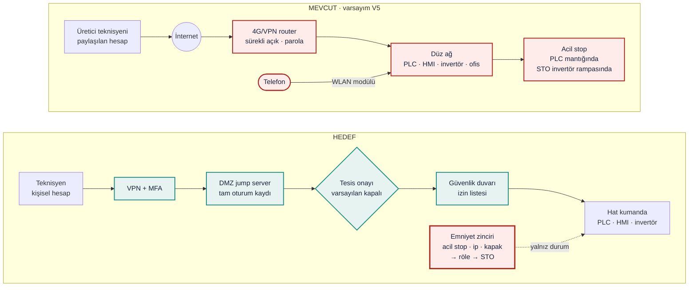

## Görev A — Mevcut → Hedef

**MEVCUT (varsayım).** Raporun Bölüm E.3'teki KOBİ pratiğine göre kuruldu [R13] [VARSAYIM]:

- Teknisyen internet üzerinden panodaki 4G/VPN router'a bağlanıyor.
- Router kurulumdan sonra sürekli açık ve paylaşılan bir parolayla korunuyor.
- Router'ın arkasında PLC, HMI, invertör ve müşteri ofisi aynı düz ağda.
- Acil stop PLC mantığından geçiyor ve durma, invertörün rampa parametresine bağlı.
- İnvertörün WLAN modülü açık.

Efo'nun gerçekten böyle çalıştığına dair bir kanıt **yok**. Bu, analiz için kurulmuş en kötü ama yaygın durumdur.

**HEDEF.** Altı öğenin her biri:

| İlke | Mevcut (varsayım) | Hedef | Dayanak |
|---|---|---|---|
| Ara nokta | Teknisyen PLC'ye IP düzeyinde doğrudan ulaşıyor | DMZ'de jump server; hatta yalnızca izin listesindeki portlar | [Y15, R14] [SEKTÖR-TİPİK] |
| VPN | Router'da sürekli açık tünel, ucu hat ağında | VPN yalnızca DMZ'ye kadar; ucu Z2'de | [R57] [SEKTÖR-TİPİK] |
| MFA | Yalnızca parola | Her atlamada ayrı MFA | [Y15] [SEKTÖR-TİPİK] |
| Kişisel hesap | Paylaşılan servis hesabı | Her teknisyene kişisel hesap; ayrıcalıklı işlemler için ayrı hesap | [Y15, R60] [SEKTÖR-TİPİK] |
| Kayıt | Yok | Tam oturum kaydı; giriş, başarısız giriş ve anormal trafik izlenir | [Y15, Y16] [SEKTÖR-TİPİK] |
| Varsayılan kapalı | Sürekli açık | Tesis onayıyla, bakım penceresi boyunca açılır, sonra kapanır | [R13] [SEKTÖR-TİPİK] |

Birinci katman (erişim güvenliği) girişi zorlaştırır, ama **imkânsız kılmaz**. İkinci katman bu yüzden şart.

## Görev B — Functional safety köprüsü

Q1 | Saldırgan tüm önlemlere rağmen içeri girerse emniyet fonksiyonu etkilenir mi? Neden?

**Mimariye bağlı. Hedef mimaride: hayır.** Ama bunun bir koşulu var.

- **Mevcut (bağımlı) mimaride: evet.** Saldırı grafında giriş noktalarından SF1'e giden 19 yol var. En kısa yol iki adım: Wi-Fi → invertör → SF1. Model 1.1'de PLC mantığı değiştirildiğinde acil stop basılsa bile bant çalışmaya devam ediyor. Rampa değiştirildiğinde el besleme ağzına ulaşıyor (2,875 m). Bunun nedeni, emniyet kararının ve durdurmanın **normal kumanda sisteminden geçmesi**.
- **Hedef (bağımsız) mimaride: hayır.** Saldırgan VPN ve MFA'yı aşmış kabul edildi. Bu durumda PLC'ye, HMI'a ve jump server'a ulaşıyor, ama SF1'e giden yol sayısı **0**. Acil stop, PLC'den bağımsız bir emniyet rölesi üzerinden STO veriyor. Bu yüzden PLC mantığının değişmesi sonucu etkilemiyor.
- **Koşul:** Bağımsızlık yalnızca sinyal yolunda yetmiyor; emniyet fonksiyonunun **varsayımlarında** da gerekiyor. SS1-t'li bağımsız varyantta, saldırgan invertör hızını 1,6 katına ve rampayı 10 s'ye çıkarınca durma mesafesi 1,600 m oluyor ve sınır (1,50 m) aşılıyor. Çünkü güvenli mesafe hesabı nominal bant hızına dayanıyor. Hızı emniyet tarafında izleyen varyantta mesafe 1,146 m'de kalıyor. Bu, aşağıdaki G3 ve G4 gereksinimlerinin nedenidir.

İçeri giren saldırgan hâlâ üretimi durdurabilir (kullanılabilirlik), ama hattaki insana zarar veremez. Föyün ikinci katmanının amacı tam olarak budur [R12, R61] [ÇIKARIM].

Q2 | Emniyet fonksiyonunun kontrol sisteminden bağımsız çalışması için **gereksinimi** yazın (çözümü değil).

PaketPro'daki "ışık perdesi zinciri uzak bakım yolundan etkilenmemeli" gereksinimi, Efo için acil stop, çekme ipi ve kapak interlock zincirine uyarlandı. Gereksinimler çözüm önermez; nasıl karşılanacağı firmanın tasarım kararıdır. Her gereksinim bir teste bağlandı (gereksinim = test).

| # | Gereksinim ve testi | 2023/1230 Ek III |
|---|---|---|
| **G1** | Acil stop, çekme ipi ve kapak interlock fonksiyonları (SF1, SF2), normal kumanda sistemi (PLC, HMI, SCADA, uzak erişim yolu) arızalansa, değiştirilse ya da ele geçirilse bile güvenli duruma geçebilmelidir. Test: `test_plc_mantigi_degisse_de_acil_stop_guvenli_duruma_goturur` | 1.2.1 |
| **G2** | Uzak bakım yolu (C1 → C3) ve geçici bakım cihazları üzerinden, emniyet zincirinin hiçbir elemanına (girişler, emniyet mantığı, STO) yazma yönünde erişim olmamalıdır. Test: `test_hedef_mimaride_emniyet_fonksiyonunu_degistirebilen_yol_sayisi_sifir`, LAB 2 K4 | 1.1.9 |
| **G3** | Durma süresini ya da mesafesini belirleyen parametreler (rampa, STO gecikmesi), ya normal kumanda sisteminden değiştirilememeli ya da emniyet fonksiyonu bu parametrelerden bağımsız bir üst sınır uygulamalıdır. Test: `test_invertor_rampasi_degisse_de_el_besleme_agzina_ulasmaz` | 1.1.9, 1.2.1 |
| **G4** | Güvenli mesafenin dayandığı bant hızı varsayımı aşıldığında emniyet fonksiyonu bunu algılamalı ve güvenli duruma geçmelidir. Test: `test_hiz_ve_rampa_birlikte_degisse_de_el_besleme_agzina_ulasmaz` | 1.2.1 |
| **G5** | Emniyet fonksiyonunun konfigürasyonu (program, parametre) yetkisiz değişikliğe karşı korunmalıdır. Her değişiklik kanıt olarak kaydedilmeli ve değişiklikten sonra fonksiyon yeniden doğrulanmalıdır. Test: LAB 4.1 graf: jump → emniyet kenarı hedefte kapalı | 1.1.9 |
| **G6** | Emniyet zincirinden normal kumandaya giden sinyaller yalnızca durum bilgisi olmalıdır. Reset ve yeniden başlatma kararı normal kumanda sisteminde verilmemeli; reset makineyi çalıştırmamalıdır. Test: `test_reset_makineyi_calistirmaz_ayri_start_gerekir` (LAB 1), LAB 2 K4 | 1.2.3 |
| **G7** | Ağ iletişiminin kesilmesi ya da bozulması emniyet fonksiyonunu güvenli olmayan bir duruma götürmemelidir. Test: `test_saldiri_yokken_her_varyant_guvenli` + LAB 1 tek arıza testleri | 1.2.1 |

Madde numaraları 2023/1230 Ek III'ün ilgili başlıklarıdır: 1.1.9 bozulmaya karşı koruma, 1.2.1 kontrol sistemlerinin emniyeti ve güvenilirliği, 1.2.3 çalıştırma. Uyumun gösterilmesi için hazırlanan FprEN 50742, 1.1.9 için kayıt ve yazılım bütünlüğü gereklerini ayrıntılandırıyor [Y16, R15] [SEKTÖR-TİPİK]. Bu tablo bir uygunluk değerlendirmesi değildir.

**Tarafsızlık notu:** Bu föy çözüm tasarlatmaz, gereksinim tanımlatır. Simülasyondaki "emniyet rölesi + SS1-t" ve "hız izleme" varyantları yalnızca gereksinimlerin test edilebildiğini göstermek içindir; bir ürün ya da tasarım önerisi değildir. Tasarım kararı firmaya aittir.

**Kanıt: simülasyon (LAB 4)**

*Eğitim amaçlı modeldir; emniyet doğrulaması değildir ve SISTEMA ya da ISO 13849-2 validasyonunun yerine geçmez.*

**4.1 Saldırı grafı.** Giriş noktası → varlıklar → emniyet fonksiyonu. Her kenarın ön koşulu var (ör. "MFA aşıldı", "düz ağ"). Bir kenar, mimarideki bütün koşulları doğruysa açık.

<!-- include-md: efo_sim/out/lab4_yollar.md -->

<!-- include-mermaid: efo_sim/out/lab4_saldiri_mevcut.mmd | Şekil 2 — Mevcut (varsayım): kırmızı kenarlar emniyet fonksiyonuna giden yolların üzerinde. Gri kesikli kenarlar kapalı ya da ulaşılamaz. -->

<!-- include-mermaid: efo_sim/out/lab4_saldiri_hedef.mmd | Şekil 3 — Hedef, saldırganın VPN ve MFA'yı aştığı kabulüyle: sarı kenarlar ulaşılabilir ama emniyet fonksiyonuna götürmüyor. SF1'e giden yol yok. -->

**4.2 Bağımsızlık.** Saldırgan PLC mantığını ya da invertör parametrelerini değiştiriyor ve acil stop basılıyor.

<!-- include-md: efo_sim/out/lab4_bagimsizlik.md -->

**Test sonuçları.** Bağımlı varyanttaki kalmalar beklenen sonuçtur (`xfail(strict=True)`): gereksinimi karşılamayan bir mimaride test kalmalıdır. Bağımsız varyantta aynı test geçer.

<!-- include-md: efo_sim/out/lab4_testler.md -->

**Yorum:** Erişim güvenliği yolların sayısını 19'dan 0'a indiriyor. Ama asıl güvence ikinci katmandan geliyor: içeri girildiği kabul edildiğinde bile SF1'e yol yok ve acil stop güvenli duruma götürüyor. Hız + rampa testinin SS1-t varyantında da kalması önemli bir bulgu: emniyetin bağımsızlığı, emniyet hesabının dayandığı **varsayımları** (bant hızı) da kapsamalı.

## Ek sorular: zafiyetler ve nasıl kapatılır

Föy dışıdır; kullanıcı isteğiyle eklendi. Öneriler genel sektör pratiğidir; Efo'nun bunları uygulayıp uygulamadığı bilinmiyor.

QE1 | Uzak erişim kayıtları neden şart?

- **Zafiyet:** Kayıt yoksa bir parametre değişikliğinin kimden geldiği, ne zaman yapıldığı ve emniyetin etkilenip etkilenmediği bilinemez.
- **Neden önemli:** 11.09.2026'dan beri CRA, aktif olarak istismar edilen zafiyetler için 24 saatlik erken uyarı, 72 saatlik bildirim ve 14 günlük nihai rapor istiyor [Y20]. 2023/1230 Ek III 1.1.9 da müdahale kanıtının toplanmasını istiyor [Y16].
- **Kapatma:** Tam oturum kaydı. Kayıtların makineden ayrı ve değiştirilemez bir yerde saklanması. "Resetleyip devam edelim" demeden önce kanıtın korunmasını içeren bir müdahale prosedürü [SEKTÖR-TİPİK].

QE2 | Bir güvenlik yaması emniyet doğrulamasını bozar mı?

- **Zafiyet:** Emniyet PLC'ye bağımlıysa her PLC yaması emniyet fonksiyonunu da etkiler. Bu durumda yeniden doğrulama gerekir ve bu da yamaların ertelenmesine yol açar [ÇIKARIM].
- **Kapatma:** Emniyet bağımsızsa normal PLC'ye yama, emniyet fonksiyonunun yeniden doğrulanmasını gerektirmez. Bu, bağımsızlığın bir başka faydası. Safety PLC ya da emniyet rölesi firmware'i değişirse ise değişiklik yönetimi ve yeniden doğrulama şart [R61] [SEKTÖR-TİPİK].

QE3 | Üreticinin kendi servis ağı ele geçirilirse ne olur?

- **Zafiyet:** Tek bir üretici ağı birçok müşterinin hattına bağlıysa, oradaki bir fidye yazılımı hepsine yayılabilir. Rapor buna tedarik zinciri saldırısı diyor (Bölüm E.3) [ÇIKARIM].
- **Kapatma:**
    - Her müşteri için ayrı kimlik bilgileri kullanmak.
    - Erişimi tesis onayına bağlamak (varsayılan kapalı).
    - Üretici tarafında da MFA ve uç nokta güvenliği uygulamak.
    - Router ve VPN cihazlarının firmware'ini güncel tutmak.

  CRA, dijital bileşenli ürünlerin üreticisine güvenlik güncellemesi ve zafiyet yönetimi yükümlülüğü getiriyor [Y20] [SEKTÖR-TİPİK].

## Ek — Kod

<!-- include-code: efo_sim/lab4_attack.py -->

<!-- include-code: efo_sim/tests/test_lab4_attack.py -->

**`params.yaml` — LAB 4 bölümü:**

<!-- include-code: efo_sim/out/lab4_params.yaml -->

**pytest çıktısı:**

<!-- include-text: efo_sim/out/pytest_lab4.txt -->
