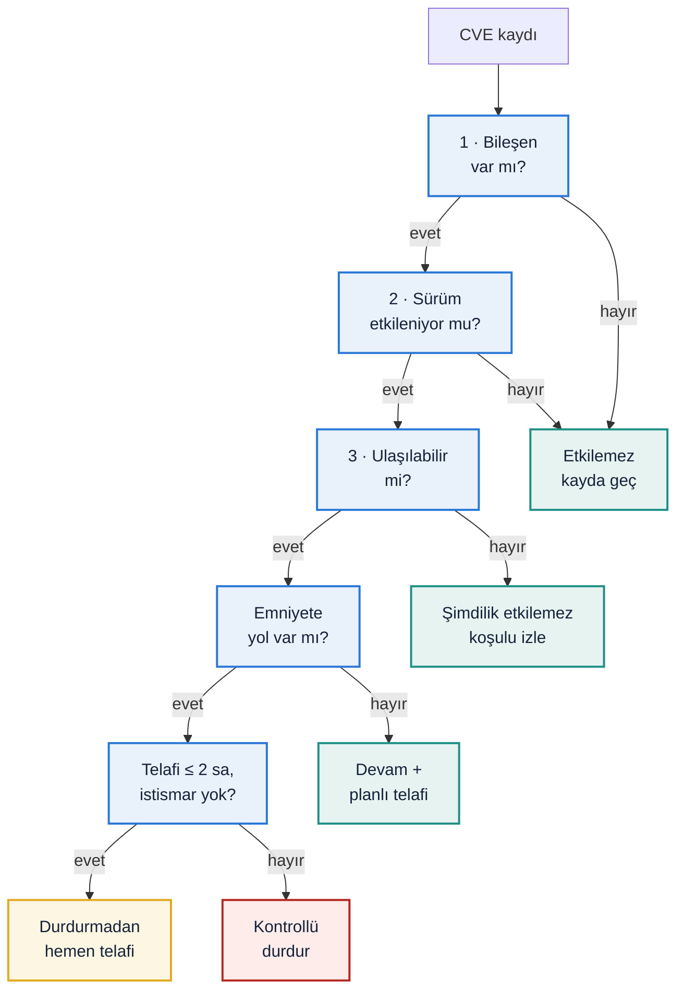

## Verilen zafiyet kaydı

| Alan | Föy | Efo karşılığı |
|---|---|---|
| Bileşen | Component X (PLC firmware kütüphanesi) | Hat PLC'sinin firmware'indeki bir kütüphane (V3, V16) |
| Sürüm | 2.4 | 2.4 |
| CVE | CVE-XXXX-XXXX | Föydeki temsilî kayıt |
| Önem | Critical (CVSS 9,8) | CVSS 9,8 tipik olarak ağdan, kimlik doğrulamasız istismar demektir [Y24] [SEKTÖR-TİPİK] |
| Yama | Mevcut | 2.5 kabul edildi (V17) |

**SBOM (varsayım).** Her bileşen, LAB 4 saldırı grafında bir düğüme bağlandı. Böylece "açık ulaşılabilir mi?" sorusu grafın üzerinde hesaplanabiliyor [Y23] [VARSAYIM].

<!-- include-md: efo_sim/out/lab5_sbom.md -->

## Görev — karar akışı

Q1 | Bu CVE sizi gerçekten etkiliyor mu? (üç şartı kontrol edin)

**Mevcut (varsayım) mimaride: evet, üç şart da sağlanıyor.**

1. **Bileşen var:** Component X, PLC firmware'inin içinde (SBOM) [VARSAYIM].
2. **Sürüm etkileniyor:** 2.4 < 2.5 (ilk düzeltilmiş sürüm) [VARSAYIM] (V17).
3. **Açık ulaşılabilir:** Düz ağda PLC'ye internetten (sürekli açık router), uzak masaüstü aracından, USB'den ve varsayılan parolalı HMI'dan ulaşılıyor (LAB 4.1).

**Hedef mimaride: yalnızca içeri girildiği kabul edilirse.** Saldırgan VPN ve MFA'yı aşarsa jump server → HMI → PLC yolundan PLC'ye ulaşıyor. Üçüncü şart da ancak bu durumda sağlanıyor.

Karşılaştırma için iki gerçek kayıt aynı akıştan geçirildi:

<!-- include-md: efo_sim/out/lab5_karar.md -->

Grafik aynı tabloyu bir zincir olarak okuyor: bir şart düştüğünde sonrakiler değerlendirilmez. Kırmızı ✔'ler riskin sürdüğü şartlar; kararı, ilk yeşil ✖'nin nerede durduğu belirliyor [ÇIKARIM].

- **CVE-2024-47100** yalnızca PLC web sunucusu açıksa ulaşılabilir. Hedefte web sunucusu kapalı olduğundan sürüm etkilense bile üçüncü şart düşüyor [Y12].
- **SSA-688146**'nın CVSS'i 9,1, ama S7-1500 ve ET 200SP içindir. Bu yüzden ilk şartta eleniyor [Y14]. Yüksek CVSS, kayıt sizi etkilemediği sürece bir şey ifade etmez.

Q2 | Üretimi hemen durdurur musunuz? Neden / neden değil?

**Hayır, kendiliğinden durdurmayız. Ama karar mimariye bağlı ve bir durdurma koşulu var.**

- **CVSS kararı vermez.** CVSS, açığın genel ciddiyetini ölçer; bu hatta neye yol açacağını söylemez [Y24]. Aynı 9,8'lik kayıt, mevcut ve hedef mimaride farklı karar alıyor (test: `test_cvss_tek_basina_karari_belirlemez`).
- **Mevcut mimaride:** PLC'den emniyet fonksiyonuna yol var (LAB 4: acil stop PLC mantığında). Yani bu açık, emniyeti bozabilen bir açık. Yine de dört telafi edici önlem 1,5 saatte açığı ulaşılamaz kılıyor (Q5). Karar: **durdurmadan hemen telafi**.
- **Durdurma koşulu:** Aktif istismar belirtisi varsa hat **kontrollü durdurulur**. Örnekler: kayıt CISA KEV kataloğunda [Y25], PLC CRC'si referanstan farklı (LAB 6), ya da telafi 2 saatte bitirilemiyor. Bu kural kodda ve testte var (`test_bagimli_emniyette_istismar_belirtisi_varsa_hat_kontrollu_durur`).
- **Hedef mimaride:** PLC ele geçirilse bile emniyet fonksiyonuna yol yok (LAB 4: 0 yol). Açık bir **kullanılabilirlik** riski, emniyet riski değil. Karar: **devam + planlı telafi**, yama bakım penceresinde. Kayıt KEV'e girerse telafi öne çekilir ama hat yine durmaz (`test_bagimsiz_emniyette_aktif_istismar_telafiyi_one_ceker_ama_hatti_durdurmaz`).

**Karar bir kez verilip kapanmaz.** Aynı kayıt zaman içinde yeni bilgi alır: KEV'e girer, telafi uygulanır, yama gelir. Model, kararı her olayda üç şart ve emniyete yol üzerinden yeniden hesaplıyor [VARSAYIM] (V23):

<!-- include-md: efo_sim/out/lab5_zaman.md -->

İki mimari aynı noktada bitiyor ama oraya farklı yoldan geliyor. Mevcut mimaride hat bir kez duruyor ve yamadan sonra emniyet fonksiyonları yeniden doğrulanıyor. Hedef mimaride hat hiç durmuyor ve yama emniyet doğrulamasını tetiklemiyor [ÇIKARIM].

Q3 | Yamayı doğrudan mı uygularsınız, önce test mi? Nerede test?

**Önce test.** PLC firmware yaması, hattı çalıştıran yazılımı değiştirir. Doğrudan uygulamak; haberleşme kaybına, proje uyumsuzluğuna ya da hattın açılmamasına yol açabilir [Y26] [SEKTÖR-TİPİK].

- **Nerede:** Aynı firmware ve aynı projeyle kurulmuş **yedek CPU'lu bir test tezgâhında**. Efo'nun atölyesinde FAT düzeni ya da müşteri sahasında hattan ayrı bir pano olabilir [VARSAYIM].
- **Sıra** (kod: `yama_adimlari`):
    1. Test tezgâhında yamayı uygula.
    2. Normal fonksiyon testleri: start/stop, yongalama interlock'u, haberleşme.
    3. Validasyon etkileniyorsa emniyet testleri: SF1–SF4 + durma süresi ölçümü (Q4).
    4. Bakım penceresinde hatta uygula; eski sürümün yedeği hazır olsun.
    5. Yeni konfigürasyonun CRC'sini referans olarak kaydet (LAB 6'da bu referansla karşılaştırma yapılıyor).

Q4 | Bu yama bir safety validation'ı etkiliyor mu? Nasıl anlarsınız?

**Mevcut mimaride evet, hedef mimaride hayır.** Anlamak için dört kontrol:

1. **Bileşen emniyet zincirinde mi?** SBOM'da emniyet rölesi ya da Safety PLC'nin firmware'i değişiyorsa validasyon her zaman etkilenir (`test_emniyet_rolesi_degisikligi_her_mimaride_validasyon_gerektirir`).
2. **Bileşenden emniyet fonksiyonuna bir bağımlılık yolu var mı?** Bu, LAB 4 grafından hesaplanıyor. Mevcutta PLC → SF1 yolu var: yama, acil stopun davranışını değiştirebilir. Hedefte yol yok: normal PLC'nin yaması emniyeti etkilemez.
3. **Üreticinin sürüm notları:** Yama emniyetle ilgili bir fonksiyonu (STO, SS1, emniyet haberleşmesi) değiştiriyor mu?
4. **Emniyet programının ve parametrelerinin CRC'si:** Yamadan önce ve sonra aynı mı?

Etkileniyorsa SF1–SF4 fonksiyon testleri ve durma süresi ölçümü tekrarlanır. Bu, LAB 4 QE2'deki bulgunun sayısal karşılığıdır: **bağımsız emniyet, yama döngüsünü hızlandırır**, çünkü her PLC yaması yeniden doğrulama gerektirmez [R61] [ÇIKARIM].

Q5 | Yama mümkün değilse compensating control (telafi edici önlem) ne olur?

Telafi edici önlem, açığı kapatmaz; **üçüncü şartı** (ulaşılabilirlik) bozar. Model, açığı ulaşılamaz kılan en kısa süreli önlem kümesini bütün alt kümeleri deneyerek buluyor [VARSAYIM] (V18):

<!-- include-md: efo_sim/out/lab5_telafi.md -->

<!-- include-mermaid: efo_sim/out/lab5_telafi_mevcut.mmd | Şekil 2 — Mevcut mimaride telafi planı LAB 4 grafında: yeşil kesikli kenarlar (✂) önlemlerin kestiği girişler. Gri kenarlar açık kalıyor ama artık hiçbir girişten ulaşılamıyor. Kırmızı kenar, PLC ele geçirilirse neyin tehlikeye girdiğini gösteriyor. -->

- **Mevcutta:** Dört önlem gerekiyor, çünkü PLC'ye dört ayrı giriş noktasından ulaşılıyor. T3 (WLAN) bu kümede yok; Wi-Fi yalnızca invertöre ulaşıyor, PLC'ye değil. Ama invertör parametreleri için ayrıca gerekli (LAB 3, S1).
- **Hedefte:** Tek önlem yetiyor: yama bitene kadar uzak bakım oturumuna onay vermemek. Bu, LAB 4'ün "varsayılan kapalı" ilkesinin doğrudan bir faydası.
- **Ek olarak** [SEKTÖR-TİPİK] [Y26]:
    - Kullanılmayan servisleri kapatmak (PLC web sunucusu → CVE-2024-47100'ü de kapatır).
    - C3 güvenlik duvarında PLC'ye yalnızca izin listesindeki portları açmak.
    - PLC'ye giden trafiği izlemek ve anormal yazma isteklerinde alarm üretmek.
    - Kaydı KEV kataloğunda izlemek; istismar başlarsa karar "durdur"a döner.

**Kanıt: simülasyon (LAB 5)**

*Eğitim amaçlı modeldir; gerçek bir zafiyet taraması ya da emniyet doğrulaması değildir. SBOM, sürümler, saha değişiklikleri ve EOL kaydı varsayımdır. Mevcut ve hedef mimari varyantları ürün önerisi değildir; mimari farkının karara etkisini göstermek için kuruldu.*

**Ne gösterildi?**

- Üç şart koddan hesaplandı; ulaşılabilirlik LAB 4 saldırı grafından geliyor.
- Karar, CVSS'e göre değil, mimariye göre değişiyor.
- Telafi planı açığı gerçekten ulaşılamaz kılıyor ve 2 saatlik sınırın içinde kalıyor.
- Validasyon ihtiyacı, bileşenden emniyet fonksiyonuna yol olup olmamasıyla belirleniyor.
- Karar her olayda (KEV, telafi, yama) yeniden hesaplanıyor; bağımsız mimaride aktif istismar bile hattı durdurmuyor.
- Güncel olmayan bir SBOM, emniyete yol açan bir açığı "etkilemez" gösterebiliyor (QE2).
- Yaması gelmeyecek bir bileşende telafi kalıcı hâle geliyor (QE3).

**Test sonuçları:**

<!-- include-md: efo_sim/out/lab5_testler.md -->

**Yorum:** En önemli bulgu, LAB 4'teki emniyet bağımsızlığının zafiyet yönetimini de değiştirmesi. Bağımlı mimaride kritik bir PLC açığı hem acil telafi hem de yeniden doğrulama gerektiriyor. Bağımsız mimaride aynı açık, planlı bir bakım işine dönüşüyor.

## Ek sorular: zafiyetler ve nasıl kapatılır

Föy dışıdır; kullanıcı isteğiyle eklendi. Öneriler genel sektör pratiğidir; Efo'nun bunları uygulayıp uygulamadığı bilinmiyor.

QE1 | CRA, Efo'dan SBOM ve yama konusunda ne istiyor?

- **Durum:** Efo dijital eleman (PLC, HMI, invertör) içeren makineleri AB pazarına arz ediyorsa, CRA'nın üretici yükümlülükleri kapsamına girebilir [ÇIKARIM].
- **İstenenler:**
    - Teknik dosyada bir SBOM.
    - Destek süresi boyunca ücretsiz güvenlik güncellemesi; rapor en az 5 yıl diyor [R16].
    - Aktif olarak istismar edilen zafiyetler için 24 sa / 72 sa / 14 gün bildirim; 11.09.2026'dan beri geçerli [Y20, Y22].
- **Kapatma:** Her makine için teslimatta bir SBOM (bileşen, sürüm, tedarikçi). Tedarikçi güvenlik bildirimlerine (Siemens ProductCERT, CISA ICS) abonelik. Müşteriye hangi kurulumun hangi sürümde olduğunu gösteren bir kayıt [Y23] [SEKTÖR-TİPİK].

QE2 | SBOM'un güncel kalmaması bir zafiyet midir?

- **Zafiyet:** Sahada yapılan her firmware güncellemesi, parça değişimi ya da uzak masaüstü aracı kurulumu SBOM'u eskitir. Eski bir SBOM'la yapılan üç şart kontrolü yanlış "etkilemez" sonucu verir [ÇIKARIM].
- **Modelde:** İki saha değişikliği kuruldu [VARSAYIM] (V21). Teslimde PLC yamalıydı (4.7, Component X 2.5). Sonra arızalı CPU, eski firmware'le gelen bir yedekle değişti ve bir teknisyen HMI'ya uzak masaüstü aracı kurdu. Hiçbiri SBOM'a işlenmedi.

<!-- include-md: efo_sim/out/lab5_sapma.md -->

- **Sonuç:** Eski SBOM, föydeki kaydı mevcut mimaride "devam" diye geçiriyor. Oysa bileşenden emniyet fonksiyonuna yol var ve doğru karar "hemen telafi" (`test_eskimis_sbom_emniyete_yol_acan_acigi_etkilemez_gosterir`). Yüksek CVSS'li bir kayıt bile, yanlış SBOM'la sessizce elenir.
- **Kapatma:** SBOM'u değişiklik yönetimine bağlamak: her değişiklikte güncellenir ve yeni CRC ile birlikte kaydedilir. Modelde bu durumda yanlış "etkilemez" sayısı sıfır (`test_degisiklik_yonetimine_bagli_sbomda_yanlis_etkilemez_sonucu_sifir`). Etkilemeyen kayıtları gerekçesiyle (ör. "web sunucusu kapalı") kaydetmek. Durum değişirse karar yeniden açılır [SEKTÖR-TİPİK] [Y23].

QE3 | Yaması hiç gelmeyecek (ömrü bitmiş) bir bileşen varsa?

- **Zafiyet:** Eski bir HMI işletim sistemi ya da üretimi durmuş bir router için yama gelmez; telafi edici önlem kalıcı hâle gelir.
- **Modelde:** Desteği bitmiş 4G router için temsilî bir kayıt kuruldu; gerçek bir CVE değildir [VARSAYIM] (V22). Düzeltme hiç gelmeyeceği için bütün sürümler etkilenir.

<!-- include-md: efo_sim/out/lab5_eol.md -->

- **Sonuç:** Mevcut mimaride karar yama penceresine bırakılamaz; telafi (T1) kalıcı olur ve bileşen değiştirme planına girer (`test_yamasi_gelmeyecek_bilesende_telafi_kalici_olur_ve_degisim_planlanir`). Hedef mimaride router hiçbir girişten ulaşılabilir değil, bu yüzden kayıt bu hatta etkili değil (`test_hedef_mimaride_eol_routera_ulasilamaz`).
- **Kapatma:** Bileşeni kendi bölgesine almak (LAB 2) ve yalnızca gerekli akışlara izin vermek. Değiştirme planını bütçelemek. Ömrü biten bileşeni SBOM'da işaretlemek [Y26] [SEKTÖR-TİPİK].

## Ek — Kod

<!-- include-code: efo_sim/lab5_vuln.py -->

<!-- include-code: efo_sim/tests/test_lab5_vuln.py -->

**`params.yaml` — LAB 5 bölümü:**

<!-- include-code: efo_sim/out/lab5_params.yaml -->

**pytest çıktısı:**

<!-- include-text: efo_sim/out/pytest_lab5.txt -->
