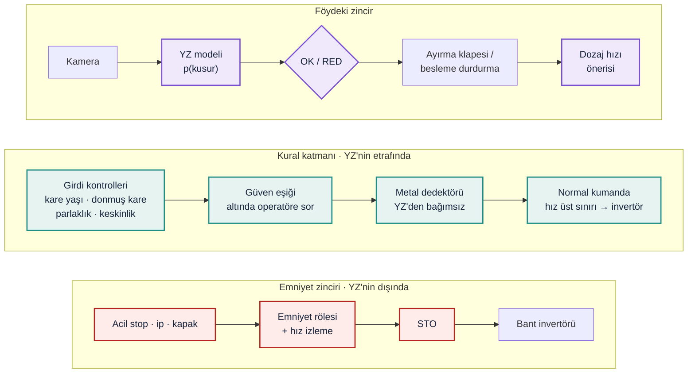

**Temel karar: YZ bir emniyet fonksiyonu değildir.** YZ bir üretim ve süreç fonksiyonudur: bıçağı ve ürün kalitesini korur. Hattaki insanı koruyan SF1–SF4 (LAB 1) YZ'den geçmez. Bu tercih bilinçli:

- Makine öğrenmesiyle davranışı gelişen ve emniyet fonksiyonu üstlenen bileşenler, 2023/1230 Ek I Kısım A'da üçüncü taraf uygunluk değerlendirmesi gereken kategoride [Y27] [SEKTÖR-TİPİK].
- Böyle bir bileşen YZ Yasası'nda da yüksek riskli sayılır [Y28] [SEKTÖR-TİPİK].
- YZ'yi emniyet zincirinin dışında tutmak, hem güvenceyi kolay doğrulanabilir bir kablolu zincirde bırakıyor hem de bu yükü doğurmuyor [ÇIKARIM].

## Görev — üç başarısızlıkta güvenli davranış

Q1 | Model yanlış sınıflandırdı: Kusurlu parçaya OK verdi. Sistem ne yapmalı? İkinci kontrol / insan onayı var mı?

**Yanlış OK'yi tek bir modelin doğruluğuna bırakmayız.** Üç katman var:

1. **Güven eşiği:** OK ancak model yeterince eminse otomatik geçer; değilse operatöre sorulur (Q3).
2. **YZ'den bağımsız ikinci kanal:** Metal dedektörü, metal parçaları YZ'den ayrı bir fiziksel ilkeyle yakalar. Dedektör "metal" derse YZ'nin OK'si geçersizdir; **bağımsız kanal kazanır**. Taş ve aşırı boy parça için ikinci kanal, yongalama makinesinin aşırı akım koruması ve operatörün periyodik numune kontrolüdür [VARSAYIM].
3. **RED her zaman kazanır:** Düşük güvenli bir RED bile parçayı ayırır. Yanlış ret yalnızca malzeme kaybıdır; yanlış OK ise bıçak hasarıdır. Fail-safe asimetri budur.

Sentetik kümede sonuç:

<!-- include-md: efo_sim/out/lab7_esik.md -->

- **Eşiksiz YZ**, kusurların %6,57'sini geçiriyor; hedef %1.
- **Güven eşiği** (0,61) hedefi karşılıyor. Bedeli, parçaların %2,18'inin operatöre sorulması.
- **Metal dedektörü** eklenince eşik 0,56'ya iniyor ve operatör yükü %0,78'e düşüyor. Bağımsız ikinci kanal, insanın yükünü de azaltıyor.

Metal dedektörü hesabı, YZ ile dedektörün hatalarının **bağımsız** olduğunu varsayıyor. Bağımsızlık gerçek kurulumda kanıtlanmalı (V20).

**Bağımsızlık bozulursa (7.4).** İki kanal aynı nedenle birlikte yanılabilir: örneğin ıslak ve iri bir yonga yığını hem kameranın görüşünü kapatır hem de dedektörün sinyalini bastırır. Model, YZ'nin kaçırdığı metal parçaların ρ kadarını dedektörün de aynı nedenle kaçırdığını kabul ediyor [VARSAYIM] (V26):

<!-- include-md: efo_sim/out/lab7_ortak_neden.md -->

Sonuç, ikinci kanalın değerinin neredeyse tamamen bağımsızlıktan geldiğini gösteriyor. Küçük bir ortak neden payı bile hedefi bozuyor (`test_ortak_neden_esigi_asilinca_kacak_hedefi_asilir`). Bu yüzden iki kanalın farklı fiziksel ilkeye dayanması ve ortak neden payının devreye almada ölçülmesi gerekiyor [ÇIKARIM] [Y29].

Q2 | Girdi manipüle edildi: Kamera verisi bozuk/sahte. Nasıl fark edilir? Şüpheli girdide ne yapılır?

**Nasıl fark edilir** (kod: `girdi_supheli`):

- **Kare yaşı:** Görüntü 200 ms'den eskiyse yayın gecikmiş ya da kayıt tekrar oynatılıyor olabilir.
- **Donmuş kare:** Aynı görüntü (aynı hash) üst üste 5 kez geliyorsa kamera donmuş ya da araya sahte bir sabit görüntü sokulmuş olabilir.
- **Parlaklık ve keskinlik:** Lens kapalı, toz kaplı ya da kamera yönü değişmiş olabilir.
- **Bağımsız sensörle tutarsızlık:** YZ "OK" derken metal dedektörü "metal" diyorsa biri yanılıyor ya da kandırılıyor.

**Şüpheli girdide:** Besleme durdurulur; sürecin güvenli durumu budur. Alarm verilir ve operatör kontrol eder. YZ'nin kararı **kullanılmaz** [Y29] [SEKTÖR-TİPİK].

<!-- include-md: efo_sim/out/lab7_girdi.md -->

**Sınır:** Bu basit kontroller, modeli kandırmak için görüntüye yerleştirilmiş bir desen gibi hedefli saldırıları yakalamaz. Bu yüzden asıl güvence ikinci kanal ve mimaridir. Kamera ile YZ arasındaki bağlantı, LAB 2'deki hat kumanda bölgesinde (Z4) tutulmalı ve dışarıdan erişilmemelidir [ÇIKARIM].

Q3 | Confidence düştü: Model "emin değilim" diyor. Eşik ne olmalı? Altında: dur / insana sor / fallback?

**Eşik, bir hedeften türetilir; tahminle seçilmez.** Kaçak hedefi (kusurların ≤ %1'i) ve operatör kapasitesi (parçaların ≤ %5'i) tanımlanır. Bu iki koşulu sağlayan en düşük eşik seçilir. Bu kümede eşik yalnız YZ ile **0,61**, metal dedektörüyle **0,56** çıkıyor.

**Eşiğin altında:**

- **OK → operatöre sor.** Besleme o parça için bekler; operatör onaylar ya da ayırır.
- **RED → ayır.** Güven düşük olsa da güvenli tarafa gidilir.
- **Operatör yoksa ya da cevap gelmezse → fallback:** Parça ayrılır ve besleme durur. Sistem hiçbir zaman "emin değilim ama geçsin" demez.

Eşik bir kez seçilip bırakılmaz. Sahadaki gerçek kaçak oranı izlenir (monitoring). Malzeme değişir de model kayarsa eşik yeniden hesaplanır.

## Karar tablosu — AI Fail-Safe Decision

| Başarısızlık | Tanımlanan güvenli davranış | Kavram |
|---|---|---|
| Model yanlış sınıflandırdı | OK yalnız güven eşiğinin üstünde otomatik geçer; YZ'den bağımsız metal dedektörü YZ'yi geçersiz kılar; RED her güvende ayırır; sahada kaçak oranı izlenir. | confidence threshold · fail-safe · monitoring |
| Girdi manipüle edildi | Kare yaşı, donmuş kare, parlaklık, keskinlik ve bağımsız sensörle tutarlılık kontrol edilir. Şüphede YZ kararı kullanılmaz, besleme durur ve alarm verilir. | monitoring · fail-safe · fallback |
| Confidence düştü | Eşiğin altında OK otomatik verilmez, operatöre sorulur. Operatör yoksa parça ayrılır ve besleme durur. | confidence threshold · human override · fallback |

## YZ'nin hız önerisi ve emniyet

YZ, sağlam ve küçük parçalarda dozaj hızını artırmayı önerebilir. LAB 4'ün bulgusu burada da geçerli: **güvenli mesafe bant hızına dayanıyor**. YZ'nin önerisi bu yüzden iki yerde sınırlanır:

1. **Normal kumanda:** Öneriyi nominal hızda keser.
2. **Emniyet tarafındaki hız izleme:** Normal kumanda atlatılsa bile bağımsız bir üst sınır uygular (LAB 4, G4).

<!-- include-md: efo_sim/out/lab7_hiz.md -->

Hız izleme olmadan, YZ'nin 3 katlık bir isteği acil stop mesafesini 2,225 m'ye çıkarıyor ve el besleme ağzına ulaşıyor. Bu test `xfail(strict=True)` ile işaretli: gereksinimi karşılamayan bir düzende kalması beklenen sonuçtur.

## YZ'nin sahadaki ömrü: kayma ve izleme

Devreye almadaki doğrulama, modelin sahada aynı kalacağını varsaymaz. Yeni bir yabancı cisim türü (ör. boyalı metal, plastik kaplı parça) modelin kusurlu parçalara verdiği skorları sağlam parçalarınkine doğru kaydırabilir (7.5) [VARSAYIM] (V26). Kaçak oranı sahada **gözlenemez**: kaçan parçayı kimse görmez. Gözlenebilen iki oran var: operatöre sorulan parçalar ve YZ'nin GEÇ dediği hâlde metal dedektörünün metal gördüğü parçalar (çelişki).

<!-- include-md: efo_sim/out/lab7_kayma.md -->

- **Operatör yükü kaymayı göstermiyor.** Kayma, modelin "emin olduğu" kararları yanlış yöne çekiyor; emin olmadığı parça sayısı pek değişmiyor (`test_operator_yuku_kaymayi_gostermez`).
- **Çelişki oranı gösteriyor.** Bağımsız kanal yalnızca kaçağı yakalamıyor, aynı zamanda YZ için bir **izleme sinyali** üretiyor. Alarm, kaçak hedefin iki katına çıkmadan çalıyor (`test_celiski_alarmi_kacak_toleransi_asilmadan_once_calar`).
- **Ama hedefin kendisi korunamıyor.** Devreye almada kaçak oranı hedefe çok yakın (%0,88'e karşı %1). Kayma başlar başlamaz hedef aşılabiliyor ve hiçbir izleme ondan önce davranamıyor. Bu test `xfail(strict=True)`: eşiği hedefe bu kadar yakın seçmek, sahada marj bırakmıyor [ÇIKARIM].

**Gereksinimler** (föyün tarafsızlık ilkesiyle: çözüm değil gereksinim; her biri bir teste bağlı):

| # | Gereksinim ve testi |
|---|---|
| **A1** | YZ'nin hiçbir çıktısı emniyet fonksiyonlarını (SF1–SF4) etkilememeli; acil stop her YZ çıktısında güvenli duruma götürmelidir. Test: `test_yz_hicbir_ciktiyla_acil_stopu_etkilemez` |
| **A2** | YZ makineyi güvenli durumdan çıkaramamalı ve çalıştıramamalı; YZ yalnızca durdurma isteyebilir. Test: `test_yz_guvenli_durumdan_makineyi_calistiramaz` |
| **A3** | YZ'nin hız önerisi normal kumandada sınırlanmalı; emniyet tarafı bu sınırdan bağımsız bir hız üst sınırı uygulamalıdır. Test: `test_yz_hiz_istegi_normal_kumandada_kesilir`, `test_kumanda_atlatilsa_da_hiz_izleme_eli_korur` |
| **A4** | Güven eşiği, tanımlı bir kaçak hedefinden ve operatör kapasitesinden türetilmeli; eşiğin altında OK otomatik verilmemelidir. Test: `test_secilen_esik_kacak_hedefini_operator_kapasitesi_icinde_karsilar`, `test_esigin_altinda_ok_otomatik_verilmez` |
| **A5** | Şüpheli girdide YZ kararı kullanılmamalı ve süreç güvenli duruma (besleme durur) geçmelidir. Test: `test_supheli_girdide_besleme_durur` |
| **A6** | YZ'den bağımsız bir kanal YZ ile çelişirse güvenli taraf (ayır) seçilmelidir. Test: `test_metal_dedektoru_yz_ile_celisirse_parca_ayrilir` |
| **A7** | YZ'nin sahadaki performansı, kaçak oranına dayanmayan gözlenebilir bir sinyalle (ör. bağımsız kanalla çelişki oranı) izlenmeli; kayma, kaçak tanımlı bir toleransı aşmadan alarm üretmelidir. İkinci kanalın ortak neden payı devreye almada ölçülmelidir. Test: `test_celiski_alarmi_kacak_toleransi_asilmadan_once_calar`, `test_ortak_neden_esigi_asilinca_kacak_hedefi_asilir` |

**Tarafsızlık notu:** Metal dedektörü, güven eşiği değerleri ve girdi kontrolleri yalnızca gereksinimlerin test edilebildiğini göstermek içindir; bir ürün ya da tasarım önerisi değildir. Tasarım kararı firmaya aittir.

**Kanıt: simülasyon (LAB 7)**

*Eğitim amaçlı modeldir. Skorlar Beta dağılımlarından üretilmiş sentetik verilerdir; gerçek bir YZ modelinin performansı değildir. ISO/IEC TR 5469 değerlendirmesinin yerine geçmez.*

**Ne gösterildi?**

- Güven eşiği tarandı; kaçak oranı azalırken operatör yükünün arttığı ve hedefin hangi eşikte karşılandığı gösterildi.
- Bağımsız ikinci kanalın hem kaçak oranını hem de operatör yükünü azalttığı gösterildi.
- Girdi kontrolleri, şüpheli her girdide beslemeyi durdurdu.
- YZ'nin hiçbir çıktısı emniyet durum makinesini (LAB 1) etkilemedi; hız önerisi, emniyet tarafındaki hız izlemeyle sınırlandı (LAB 4).
- İkinci kanalın katkısı bağımsızlığa bağlı: küçük bir ortak neden payı hedefi bozuyor (7.4).
- Sahadaki kaymayı operatör yükü değil, YZ ile bağımsız kanal arasındaki çelişki oranı yakalıyor (7.5).

**Test sonuçları:**

<!-- include-md: efo_sim/out/lab7_testler.md -->

**Yorum:** "Prediction ≠ Safety" ilkesinin sayısal karşılığı şu: model ne kadar iyi olursa olsun %0 kaçak vermiyor. Güvenlik, modelin etrafındaki kurallardan (eşik, ikinci kanal, girdi kontrolleri) ve YZ'nin hiç dokunamadığı emniyet zincirinden geliyor.

## Ek sorular: zafiyetler ve nasıl kapatılır

Föy dışıdır; kullanıcı isteğiyle eklendi. Öneriler genel sektör pratiğidir; Efo'nun bunları uygulayıp uygulamadığı bilinmiyor.

QE1 | Kamerayı besleme ağzına yaklaşan insanı algılamak için de kullanabilir miyiz?

- **Risk:** YZ ile insan algılama, ışık perdesi ya da çekme ipinin yerine geçerse emniyet fonksiyonu bir tahmine bağlanır. Model bir insanı kaçırırsa sonuç ölümcül olabilir (LAB 1, S2) [ÇIKARIM].
- **Kapatma:** YZ ile insan algılama yalnızca **ek bir uyarı** olarak kullanılabilir (ör. sesli ikaz, bandı yavaşlatma isteği). SF1–SF4 kablolu zincirde kalır. Emniyet fonksiyonu YZ'ye verilecekse 2023/1230 Ek I Kısım A kapsamında üçüncü taraf uygunluk değerlendirmesi gerekir [Y27, Y29] [SEKTÖR-TİPİK].

QE2 | Model güncellemesi bir yazılım değişikliği midir?

- **Zafiyet:** Yeni bir model dosyası, firmware yaması kadar davranışı değiştirir. Ama çoğu zaman "sadece veri" sanılıp test edilmeden yüklenir [ÇIKARIM].
- **Kapatma:** Model sürümünü SBOM'a eklemek ve LAB 5'teki akıştan geçirmek: önce test kümesinde kaçak oranı ölçülür, eşik yeniden hesaplanır, sonra bakım penceresinde yüklenir. Model dosyasının özet değeri (hash) kaydedilir ve olay anında referansla karşılaştırılır (LAB 6) [SEKTÖR-TİPİK].

QE3 | YZ'nin kararları kaydedilmeli mi?

- **Neden önemli:** Bir bıçak hasarından sonra "YZ o parçaya ne dedi, güveni neydi?" sorusu cevaplanabilmeli. 2023/1230 Ek III 1.2.1, kendi kendine gelişen davranışlı emniyet sistemleri için emniyetle ilgili karar sürecinin kaydını istiyor [Y27] [SEKTÖR-TİPİK]. Bu proje emniyet fonksiyonu olmadığı için kapsamda değil, ama aynı pratik izlemeyi mümkün kılar [ÇIKARIM].
- **Kapatma:** Her kararın zamanını, model sürümünü, skorunu ve eylemini kaydetmek. Kaçak ve operatör onay oranını vardiya bazında izlemek; kayma görülürse eşiği yeniden hesaplamak.

## Ek — Kod

<!-- include-code: efo_sim/lab7_ai.py -->

<!-- include-code: efo_sim/tests/test_lab7_ai.py -->

**`params.yaml` — LAB 7 bölümü:**

<!-- include-code: efo_sim/out/lab7_params.yaml -->

**pytest çıktısı:**

<!-- include-text: efo_sim/out/pytest_lab7.txt -->
